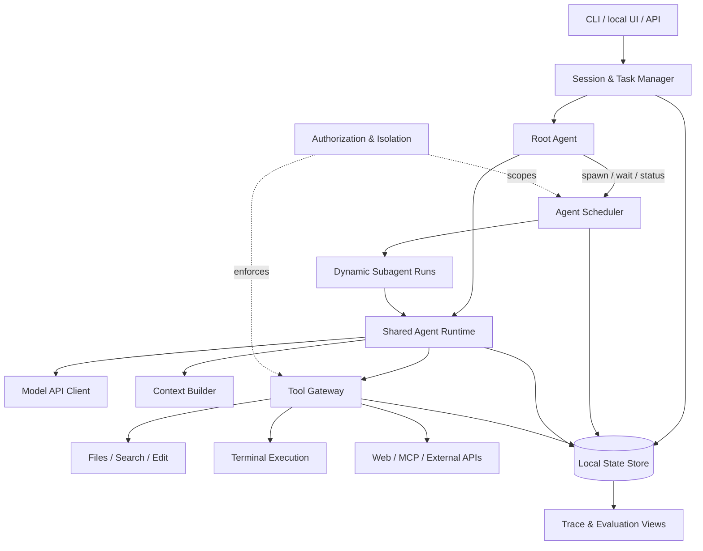
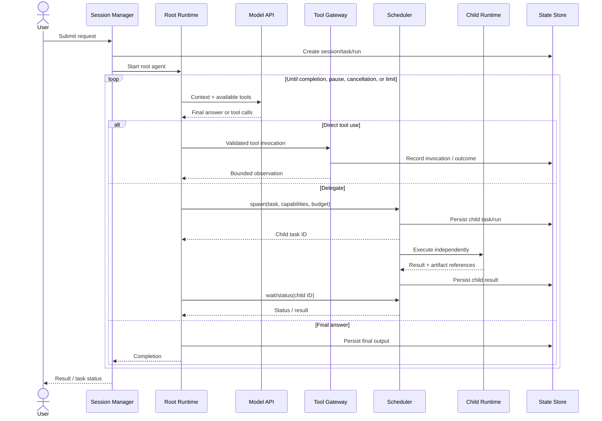

# Personal Agent System — Architecture Overview

> **Status:** Working design · **Version:** 0.1 · **Last updated:** 2026-11-07  

## 1. Purpose

Build a **local-first, general-purpose personal agent system** that can accomplish work on a Mac and through external services, while exposing the mechanics of a custom agent harness for experimentation and learning.

This document describes the **current intended architecture**, not a permanent record of design decisions. It will change as designs are validated and implemented. Accepted **Personal Agent Proposals (PAPs)** are immutable records of why material decisions were made; this document should reference them as they are accepted.

### Design principles

- **Model-directed behavior:** Let the model choose how to approach a task, use tools, and delegate work. Do not require a predefined workflow or specialist role.
- **One root per session or job:** Each independent user session or scheduled job has one root agent. Different sessions may run concurrently; there is no single global agent process controlling everything.
- **Dynamic subagents:** A root agent may spawn ephemeral agents with a specific objective, independent context, and a subset of its authorized capabilities.
- **One shared runtime:** Root agents and subagents execute through the same generic model/tool loop.
- **Small, composable tool surface:** Prefer a few useful operations over many hardcoded task-specific workflows. Minimal tool count is a design preference, not an objective in itself.
- **Separate reasoning from guarantees:** Models decide *what to attempt*; trusted infrastructure handles authorization, scheduling, persistence, and reconciliation of side effects.
- **Local-first, incremental:** Start with a modular application on the Mac; add distributed services only if needed.

## 2. Logical architecture

These boxes are **logical responsibilities, not microservices**. The initial implementation can be a single Python process with asynchronous execution and a local database. The model API and any third-party tools are remote dependencies. A command sandbox may be a separate OS process or container.

### Component boundaries

| Component | Owns | Does not own |
| --- | --- | --- |
| **Session & Task Manager** | User sessions, root requests, task identifiers and lifecycle | Model planning |
| **Shared Agent Runtime** | Model/tool loop, context assembly, output handling, run-level limits | Tool permissions or task scheduling policy |
| **Root Agent** | User-facing reasoning, direct tool use, optional delegation, final synthesis | Global infrastructure state |
| **Agent Scheduler** | Child task creation, concurrency, dependencies, cancellation, task status | Deciding the semantic objective of a child |
| **Tool Gateway** | Registry, argument validation, authorization, execution, bounded observations | Model reasoning |
| **Context Builder** | Constructing model input from current state, history, and selected retrieval | Rewriting the authoritative execution history |
| **Persistence** | Sessions, tasks, runs, tool invocations, events, and artifact references | Planning decisions |
| **Authorization / Isolation** | Trusted capability scopes, approvals, filesystem and process isolation | Prompt-based security guarantees |

## 3. Agent model

An **agent** is an execution of the shared runtime with a task, instructions, model configuration, context, capabilities, and resource limits. It is **not** a predefined `ResearchAgent` or `CodingAgent` class.

- A **root agent** starts for each independent session/job and may execute ordinary tools itself.
- A **subagent** is spawned by the root when the model judges delegation worthwhile; its instructions and available tools are selected for that task.
- Each subagent has **its own conversation/context**, task ID, execution history, and budget.
- The parent receives a task handle immediately (for asynchronous work) and later a concise result plus links/references to detailed artifacts or logs.
- **Initial constraint:** only roots can spawn subagents. Recursive delegation is deferred until budgets, cancellation propagation, and ownership are well-defined.

**Capability rule:** A child may receive only a subset of the capabilities already granted to its parent. Capabilities include resource scopes (for example, a filesystem root or account scope), not merely tool names. The same rule applies to the root's ability to use terminal execution.

## 4. Request lifecycle

**Delegation is optional.** An ordinary request may require only a single model turn or a few direct tool calls. Planning is implicit in the model unless it elects to record a plan.

## 5. Initial tool design

Expose a **small model-facing interface** backed by more detailed infrastructure. Suggested initial operations:

| Tool | What the model can do | Notes |
| --- | --- | --- |
| `terminal.exec` | Execute a bounded command in an approved environment | Useful general primitive; not unrestricted host access |
| `file.read` | Read a file or line range | Bound output and check path permissions |
| `file.search` | Find paths and search contents | Avoid consuming context with large raw results |
| `file.edit` | Create or apply targeted edits | Detect changed files and conflicting writes |
| `agent.spawn` | Create a scoped child task | Root-only initially; returns a task ID |
| `agent.wait` | Await or retrieve child results | Prefer waiting on several IDs at once |
| `agent.status` | Check child/task progress | May be combined with `agent.wait` later |

**Next useful integrations:** `web.search` and `web.fetch`, then user-interaction/approval operations, then MCP and authenticated personal-service tools. These should use the same tool gateway, not special agent classes.

### Why have file tools if there is a terminal?

A terminal is expressive, but dedicated file tools can provide bounded results, structured errors, optimistic concurrency checks, and narrower authorization. Conversely, duplicating every shell operation as a bespoke tool would bloat the interface. The goal is a pragmatic minimal set, measured against actual agent performance.

**Security invariant:** File-tool restrictions are meaningless if the terminal can bypass them. The terminal must execute under a matching OS/container filesystem and credential boundary. Sensitive host actions or external account mutations require explicit capability grants and, where appropriate, human approval.

## 6. State and context

Model the following entities from the start:

| Entity | Meaning |
| --- | --- |
| `Session` | Conversation or independent job boundary |
| `Task` | Objective, parent, dependencies, status, result reference |
| `AgentRun` | A particular attempt to execute a task |
| `Message` | User, model, tool, or agent exchange |
| `ToolInvocation` | Request, authorization decision, execution status, observation |
| `ExecutionEvent` | Append-only event for reconstruction and diagnostics |
| `Artifact` | Produced file or externally stored result with provenance |

A **task** is the durable unit of work; an **agent run** is an attempt. Retrying a task creates a new run and must not assume previous side effects did not occur.

Persist enough data to inspect the full history; construct a bounded model context separately. Prefer **selective retrieval of exact historical material** to relying solely on lossy summaries. Compaction can be an optimization, not the authoritative history. Long-term user memory is a later subsystem and should not be confused with run/session history.

### Concurrency and recovery

- Child tasks can run concurrently when their resource scopes and dependencies permit.
- Concurrent access to the same writable resource needs isolation, version checks, locks, or an explicit merge/reconciliation step.
- Persist intent before an external side effect and the result afterward; some operations may still have an **unknown** outcome after a crash.
- Never blindly replay non-idempotent shell commands or external mutations. Reconcile first or require user approval.
- Support explicit cancellation, timeout, and aggregate token/tool-call budgets for a parent and its descendants.

The first milestone needs event logging; full crash recovery and concurrent conflict handling are later milestones, not implied to be solved by `asyncio` alone.

## 7. Deployment and implementation trajectory

**Starting environment:** Mac, Python, OpenAI model APIs, local CLI, SQLite, and a modular `asyncio` runtime. These are provisional implementation choices, not irreversible architecture commitments.

| Milestone | Deliverable | Validation |
| --- | --- | --- |
| **M1 · Root agent** | Custom model/tool loop, CLI, file/terminal tools, bounded execution, trace events | Inspect project, make an authorized edit, run a test, summarize output |
| **M2 · Subagents** | Dynamic spawn/wait/status, independent context, capability inheritance | Delegate a task and incorporate its result without merging histories |
| **M3 · Durable coordination** | Concurrent children, task persistence, cancellation, conflict checks, recovery | Resume/reconcile interrupted work and avoid conflicting writes |
| **M4 · Integrations** | Web tools, MCP, approvals, scoped external APIs | Complete cross-service tasks without bypassing permissions |
| **M5 · Context & memory** | Historical retrieval, long-term memory, evaluation and cost tracking | Compare root-only and delegated runs on quality, latency, and expense |

## 8. Open design questions

The following are **not yet settled** and should be explored before becoming immutable PAP decisions:

1. **Terminal boundary:** Restricted host process, container workspace, or both? What must an agent never execute without approval?
2. **Tool capability model:** Exact representation of scopes, inheritance, grants, and revocation.
3. **Tool-call semantics:** Handling multiple tool calls, concurrent calls with side effects, retries, cancellation, and timeouts.
4. **Task scheduling:** In-process queue versus durable worker architecture; how recovery and user-facing progress work.
5. **Agent communication:** Parent/child results initially; whether direct peer-to-peer messaging is ever useful.
6. **Context strategy:** Retrieval indexes, full-history storage, model input budgeting, and compaction policy.
7. **Subagent cost-benefit:** Under which tasks does delegation demonstrably outperform one capable root agent?
8. **Personal integrations:** What accounts and local system permissions are actually needed for useful daily workflows?

## 9. Documentation relationship

- **This file (`docs/architecture/system-overview.md`):** Mutable overview of current intended design. Update when accepted decisions or validated implementation change it.
- **`docs/pap/`:** Short, immutable proposals documenting the rationale, alternatives, and consequences behind significant decisions. Acceptance freezes a PAP; later changes require a new PAP.
- **Implementation and operational docs:** Mutable instructions for code, configuration, testing, and deployment.

**Candidate PAP topics:** Dynamic agent model; generic agent runtime; tool capability model and terminal isolation; delegation/scheduling; persistence and recovery; context history/retrieval. Numbers are assigned through the PAP process, not precommitted in this document.
